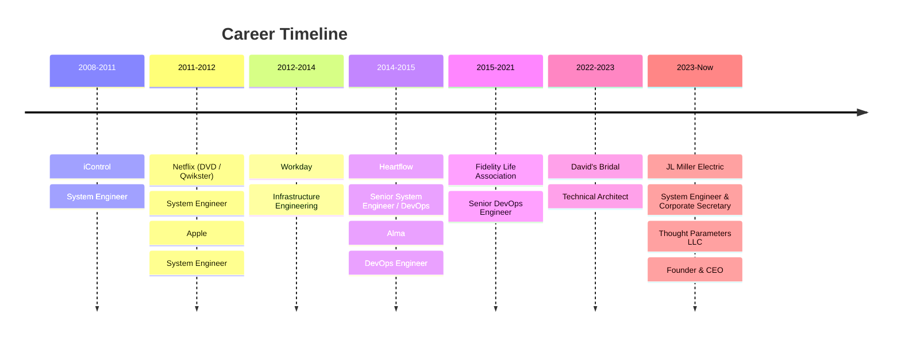

<!-- Profile README for github.com/jasonmiller-cc -->

  

<h1 align="center">Jason Lee Miller</h1>

<h3 align="center">DevOps &amp; Cloud Security Engineer · Founder &amp; CEO, <a href="https://thoughtparameters.com">Thought Parameters LLC</a></h3>

  <b>I ship software, automate infrastructure, and lock down systems.</b> 
  15+ years building and operating production platforms for Netflix, Apple, Workday, and regulated enterprises.

  
  
  
  
  

  
  
  
  

---

## 📇 Contents

[About](#-about) · [Thought Parameters](#-thought-parameters-llc) · [Impact](#-impact-by-the-numbers) · [Tech Stack](#%EF%B8%8F-tech-stack) · [Experience](#-experience) · [Credentials](#-certifications--education) · [Projects](#-featured-projects) · [Writing](#%EF%B8%8F-latest-writing) · [Work With Me](#-work-with-me)

---

## 👋 About

I turn fragile, hand-built infrastructure into **automated, observable, and auditable platforms**, and I do it fast. My career runs from racking servers and writing F5 iRules to running zero-downtime migrations at Netflix, auditing 10,000+ servers at Workday, and today leading my own engineering firm.

- 🏗️ **Platform engineering:** Terraform-first AWS and GCP foundations, Kubernetes, and GitHub Actions pipelines that eliminate drift and manual toil.
- 🔐 **Security by default:** DevSecOps, least-privilege IAM, zero-trust networking, and PCI / HIPAA / SOC 2 readiness built into the pipeline, not bolted on afterward.
- 📈 **Reliability and observability:** SRE practices, Splunk, Elasticsearch, New Relic, Sentry, and Zabbix so problems surface before customers notice.
- 💰 **FinOps:** I find the waste. Account consolidation and right-sizing that pays for the engagement.
- 🤖 **AI-accelerated delivery:** Claude Code, Amazon Bedrock, Strands Agents, and MCP integrations, with governance and guardrails built in.

> [!TIP]
> **Hiring or need a team?** Send me a [LinkedIn message](https://www.linkedin.com/in/jasonmiller-cc/) with what you're building, what's broken, or what you can't hire for fast enough. I read every one and reply personally.

---

## 🚀 Thought Parameters LLC

  

**[Thought Parameters](https://thoughtparameters.com)** is my Orange County–based computer systems design consultancy. We give startups and lean IT teams senior engineering talent without a six-month hiring search: we design, build, and **operate** systems that are secure, scalable, and built to last.

<table>
  <tr>
    <td width="33%" valign="top">
      <h4>💻 Software Development</h4>
      Web, mobile, and desktop apps, APIs, and legacy modernization. Shipped with CI/CD and tests from the first commit.
    </td>
    <td width="33%" valign="top">
      <h4>☁️ DevOps &amp; Cloud</h4>
      CI/CD pipelines, Terraform, Kubernetes, AWS and GCP. Landing zones, migrations, and cost reduction.
    </td>
    <td width="33%" valign="top">
      <h4>🛡️ Security &amp; Compliance</h4>
      DevSecOps, cloud security posture, identity, and SOC 2 / HIPAA / PCI readiness that holds up to an audit.
    </td>
  </tr>
</table>

### 🧩 Built by Thought Parameters

| Product | What it is | Built with |
| :-- | :-- | :-- |
| **[SyntaxRoot](https://syntaxroot.cc)** | ITSM and CMDB for lean IT teams and MSPs: incident, problem, and change management, CMDB relationship mapping with cloud discovery, SLA tracking, and a knowledge base | AWS Lambda, API Gateway, RDS PostgreSQL, Terraform, GitHub Actions, Cloudflare |
| **[Subnet Calculator](https://subnet.thoughtparameters.com)** | Free IPv4/IPv6 subnet calculator for network and cloud engineers | Gatsby, Cloudflare Pages |

**How we engage:** short sprints or long-term embeds · **C2C**, **1099**, or **W-2** · remote across the US, on-site in Southern California.

  
  

---

## 📊 Impact by the Numbers

| Result | How |
| :-- | :-- |
| **35%** lower operating spend | Automation, platform standardization, and removal of manual toil |
| **60%** reduction in critical security risk | DevSecOps controls, CIS-aligned hardening, and auditable IaC |
| **$2,000 / month** saved on AWS | Consolidated 10 AWS accounts and decommissioned idle EC2, RDS, and S3 at David's Bridal |
| **300+** storefront pages monitored | New Relic scripted synthetics that caught customer-facing incidents early |
| **10,000+** servers audited | Orchestration-driven compliance audits with Workday InfoSec |
| **Zero-downtime** CI/CD migration | Moved Jenkins and revenue-tracking services through the Netflix–Qwikster split |
| **75%** faster bare-metal builds | PXE + iDRAC zero-touch Kickstart provisioning at iControl |

---

## 🛠️ Tech Stack

> [!NOTE]
> 🔎 **Want to search or filter?** Open **[`data/skills.csv`](data/skills.csv)**. GitHub renders it as a searchable table with 40+ skills, proficiency levels, years, and where I used each one.

| Domain | Tools |
| :-- | :-- |
| **Cloud** |     |
| **IaC &amp; Config** |       |
| **Containers** |     |
| **CI/CD** |     |
| **Observability** |        |
| **Security** |       |
| **Languages** |        |
| **Systems &amp; Network** |       |
| **AI** |      |

---

## 💼 Experience

> [!NOTE]
> 🔎 Full searchable history with highlights and stack per role: **[`data/experience.csv`](data/experience.csv)**

| Years | Company | Role | Highlights |
| :-- | :-- | :-- | :-- |
| 2024 – Now | **[Thought Parameters LLC](https://thoughtparameters.com)** | Founder &amp; CEO | Built and run SyntaxRoot (serverless ITSM/CMDB); Terraform-first GCP and AWS foundations for clients; DevSecOps and GRC programs |
| 2023 – Now | **JL Miller Electric, Inc.** | System Engineer &amp; Corporate Secretary | Serverless static hosting migration; Windows/Linux patching and hardening baselines |
| 2022 – 2023 | **David's Bridal** | Technical Architect | $2K/mo AWS savings across 10 accounts; Splunk HEC + Fluent Bit pipelines; New Relic synthetics on 300+ pages; PCI remediation with Orca |
| 2015 – 2021 | **Fidelity Life Association** | Senior DevOps Engineer | Jenkins pipelines gating GitLab merges with Checkmarx; Puppet + MCollective release framework; Sentry migration to SaaS |
| 2014 – 2015 | **Alma, Inc.** | DevOps Engineer | Automated deploy and test pipelines for a distributed team |
| 2014 | **Heartflow, Inc.** | Senior System Engineer / DevOps | SaltStack deployment automation in a regulated medical-device company |
| 2012 – 2014 | **Workday** | Infrastructure Engineering | Audited 10,000+ servers with InfoSec; Chef + ChefSpec CI across 7 international sites |
| 2011 – 2012 | **Apple** | System Engineer | HA infrastructure for a 3,000+ seat research org; reproducible Gentoo build environments |
| 2011 – 2012 | **Netflix (DVD / Qwikster)** | System Engineer | Zero-downtime Jenkins migration; Puppet across 2,000+ servers and a 10,000+ instance CloudStack cloud |
| 2008 – 2011 | **iControl, Inc.** | System Engineer | F5 / A10 automation; zero-touch PXE provisioning (75% faster builds) |

---

## 🎓 Certifications &amp; Education

| Credential | Issuer | Status |
| :-- | :-- | :-- |
| 🏅 **Terraform Associate (004)** | HashiCorp | Active · Mar 2026 |
| 🏅 **GitHub Foundations (GH-900)** | Microsoft / GitHub | Active · Feb 2026 |
| 🎓 B.S. Computer Information Systems | DeVry University | In progress |
| 🎓 A.A.S. Information Technology &amp; Networking | DeVry University | Expected Nov 2026 |
| 📜 Certificate in Programming Essentials, with Honors | DeVry University | Feb 2026 · GPA 3.88 |
| 📜 Certificate in Cybersecurity, with Honors | DeVry University | Apr 2025 · GPA 3.81 |

🔎 Searchable: [`data/credentials.csv`](data/credentials.csv)

---

## 📦 Featured Projects

| Project | Description | Lang |
| :-- | :-- | :-- |
| **[profile-generator](https://github.com/jasonmiller-cc/profile-generator)** | Browser-based GitHub profile README and portfolio page generator. No sign-up, no build step, pure HTML/JS/CSS | JavaScript |
| **[python-linting](https://github.com/jasonmiller-cc/python-linting)** | Python quality gate for GitHub Actions: Black, Pylint, and MyPy in one step | YAML |
| **[python-unit-testing](https://github.com/jasonmiller-cc/python-unit-testing)** | Pytest execution, coverage tracking, and enforced quality gates for every release | YAML |
| **[golang-unit-testing](https://github.com/jasonmiller-cc/golang-unit-testing)** | Reusable GitHub Action for Go unit testing | Go |
| **[html5](https://github.com/jasonmiller-cc/html5)** | Python tooling for HTML5 | Python |

---

## ✍️ Latest Writing

<!-- BLOG-POST-LIST:START -->
- [Killing the Hero Culture](https://www.jasonmiller.cc/blogs/killing-the-hero-culture/)
- [Understanding Your Impact](https://www.jasonmiller.cc/blogs/understanding-your-impact/)
- [Github Workflows](https://www.jasonmiller.cc/blogs/github-workflows/)
- [Résumé](https://www.jasonmiller.cc/resume/)
<!-- BLOG-POST-LIST:END -->

Auto-updated daily from [jasonmiller.cc](https://www.jasonmiller.cc). More on [LinkedIn](https://www.linkedin.com/in/jasonmiller-cc/recent-activity/all/).

---

## 🤝 Work With Me

  

| You need… | I deliver… |
| :-- | :-- |
| A platform that stops breaking at 2 a.m. | SRE practices, observability, runbooks, and automated remediation |
| Cloud bills that keep growing | A FinOps review with concrete consolidation and right-sizing cuts |
| An audit coming up | DevSecOps controls and evidence for PCI, HIPAA, or SOC 2 readiness |
| Infrastructure nobody wants to touch | Terraform, GitOps, and CI/CD so every change is reviewed, tested, and repeatable |
| Senior help now, not in six months | A senior engineer, or a Thought Parameters team, plugged into yours within days |

  
  

---

  📍 Placentia, Orange County, CA · Working with teams anywhere 
  Images: <a href="https://unsplash.com/@resaasadi?utm_source=jasonmiller-cc_profile&utm_medium=referral">Reza Asadi</a>, <a href="https://unsplash.com/@hyewonphotography?utm_source=jasonmiller-cc_profile&utm_medium=referral">HYEWON HWANG</a>, and <a href="https://unsplash.com/@zoshuacolah?utm_source=jasonmiller-cc_profile&utm_medium=referral">Zoshua Colah</a> on <a href="https://unsplash.com/?utm_source=jasonmiller-cc_profile&utm_medium=referral">Unsplash</a>

